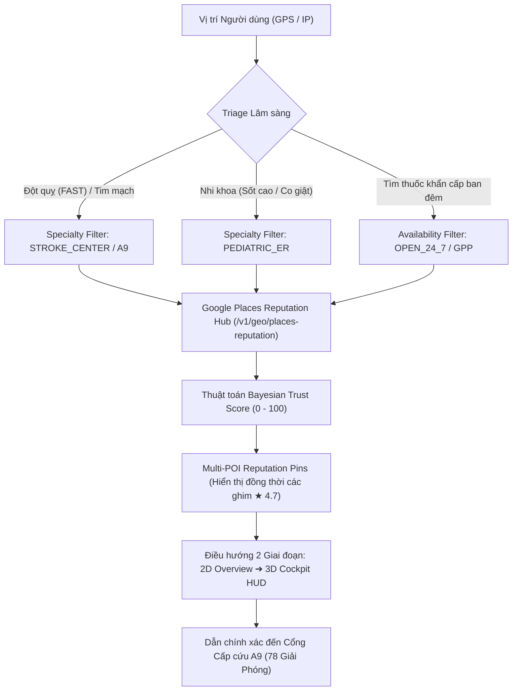

# KẾ HOẠCH THIẾT KẾ HỆ THỐNG BẢN ĐỒ CẤP CỨU & TÌM THUỐC REAL-TIME
## TÍCH HỢP GOOGLE MAPS PLACES API REPUTATION & MODULE 10 (googlePlacesReputationAndRealtimeNav.ts)
**Hệ thống mục tiêu:** MedGuard AI Clinical Workspace (`https://medguard.bookingcare.shop`)  
**Tài liệu mã số:** `MEDGUARD-ARCH-2026-M10`  
**Phiên bản:** `v2.4.0-Production`  
**Cập nhật lần cuối:** 28/10/2026  
**Trạng thái triển khai:** Đã tích hợp trực tiếp trên ứng dụng (Tab “Bản đồ Cấp cứu, Tìm Thuốc & Google Places”)

---

## MỤC LỤC TỔNG THỂ
1. **Đánh giá Thực trạng An toàn Khẩn cấp & Phân tích Nguyên nhân Lỗi (Root Cause Analysis)**
   - Tình huống A (BUG-21): Tìm mua thuốc khẩn cấp & Sai lệch dữ liệu uy tín
   - Tình huống B (BUG-22): Xếp hạng cấp cứu theo khoảng cách chim bay & Sai cổng đón bệnh
   - Tình huống C (BUG-23): Chỉ đường Real-Time, lỗi dịch thuật và góc nhìn bản đồ bị che khuất
2. **Kiến trúc Giải pháp 4 Trụ Cột Tích hợp Google Maps Places API**
   - Trụ cột 1: Làm giàu dữ liệu Uy tín qua Google Maps Places API (`/v1/geo/places-reputation`)
   - Trụ cột 2: Thuật toán Bayesian Weighted Medical Trust Score (0–100)
   - Trụ cột 3: Điều phối Phân luồng Cấp cứu Chuyên khoa (Specialty-Aware Triage) & Tọa độ Cổng Cấp cứu A9 Bạch Mai (78 Giải Phóng)
   - Trụ cột 4: Chuẩn hóa HUD Điều hướng 2 Giai đoạn (2D Overview ➔ 3D Cockpit) & Dịch thuật Tiếng Việt 100%
3. **Mã Nguồn Chi Tiết Module 10 (`googlePlacesReputationAndRealtimeNav.ts`)**
4. **Cập nhật Backend & Tích hợp Bộ Dữ liệu Cơ sở Y tế Hybrid**
5. **Tổng hợp Lộ trình 10 Module Khắc phục Hệ Thống MedGuard AI (M1 – M10)**
6. **Hướng dẫn Tải về (.DOC / .MD) & Kiểm thử Trực tiếp**

---

## 1. ĐÁNH GIÁ THỰC TRẠNG AN TOÀN KHẨN CẤP & NGUYÊN NHÂN LỖI

### Kết luận Đánh giá:
**CHƯA ĐÁP ỨNG AN TOÀN TRONG TÌNH HUỐNG KHẨN CẤP THỰC TẾ** nếu chỉ dựa vào dữ liệu thô từ OpenStreetMap (OSM) và sắp xếp thuần túy theo khoảng cách đường chim bay (`distance_km`).

### Tình huống A — Người dùng khẩn cấp tìm mua thuốc gần nhất (GET /v1/geo/pois?poi_type=pharmacy)
1. **Đưa nút giao thông vô danh lên Top 1 (BUG-21):**
   - Tại khu vực Giải Phóng / Phương Mai (tọa độ `21.0031, 105.8401`), hệ thống từng đề xuất số 1 là `"Nhà thuốc Giai Phong Road"` (`0.16 km`). Đây là một node đường giao thông OSM bị gắn nhầm nhãn `healthcare.pharmacy`, không phải nhà thuốc có thật.
2. **Gắn cứng SĐT tổng đài FPT Long Châu (1800 6928) cho mọi hiệu thuốc tư nhân nhỏ lẻ:**
   - Trong dữ liệu cũ, mọi nhà thuốc độc lập (`Nhà thuốc Long Tâm`, `Quầy thuốc số 5`...) đều bị gán cứng `hotline: "1800 6928"` và `phone: "1800 6928"`. Khi bệnh nhân cần hỏi thuốc cấp cứu trong đêm sẽ gọi nhầm tổng đài chuỗi.
3. **Gắn cứng giờ mở cửa giả định ("Mở cửa từ 06:30 - 22:30" / OPEN_NOW):**
   - Mọi cơ sở đều báo mở cửa dù người dùng truy cập lúc 23:30 đêm, dẫn bệnh nhân đến quầy thuốc đóng cửa thay vì chuỗi 24/7 hoặc nhà thuốc Bệnh viện Bạch Mai cách đó 250m.
4. **Thiếu hoàn toàn chỉ số Uy tín Google Maps:**
   - Không có điểm đánh giá sao (`rating`), số lượng review (`userRatingCount`), bình luận thực tế (`reviews`) để phân biệt nhà thuốc đạt chuẩn GPP với quầy tạp hóa bán thuốc.

### Tình huống B — Người dùng khẩn cấp tìm Bệnh viện Uy tín để Cấp cứu (GET /v1/geo/pois?poi_type=emergency)
1. **Xếp hạng thuần theo khoảng cách chim bay, dẫn sai chuyên khoa (BUG-22):**
   - Tại tọa độ `21.0031, 105.8401`, hệ thống xếp:
     - `#1`: Bệnh viện Việt Pháp Hà Nội (`0.04 km` — Bệnh viện quốc tế tư nhân, chi phí cao, không tối ưu cho cấp cứu BHYT phổ thông).
     - `#2`: Bệnh viện Lão khoa Trung ương (`0.06 km` — Chuyên khoa người cao tuổi). Khi bệnh nhân là trẻ 14 tháng sốt cao co giật hoặc người trẻ nghi đột quỵ não, hệ thống vẫn xếp Lão khoa lên trên Bệnh viện Bạch Mai.
     - `#3`: Bệnh viện Bạch Mai (`0.25 km` — Bệnh viện Đa khoa Hạng Đặc biệt với Trung tâm Cấp cứu A9 & Đơn vị Đột quỵ toàn diện).
2. **Định vị vào tâm tòa nhà đa giác thay vì Cổng Khoa Cấp cứu:**
   - Bệnh viện Bạch Mai rộng hàng chục hecta, các cổng phụ đóng vào ban đêm. Dẫn đường vào tâm đa giác làm mất 10–15 phút "giờ vàng" tìm lối vào cấp cứu.

### Tình huống C — Chỉ đường Real-Time (POST /v1/geo/route & Component Z7)
1. **Câu lệnh tiếng Anh chưa dịch kèm tên đường giả ("Đoạn đường di chuyển") (BUG-23):**
   - Các câu lệnh `Turn left.`, `Turn right.`, `Keep right to stay on...` bị bỏ sót do có dấu chấm câu, đồng thời hệ thống gắn cứng `road_name: "Đoạn đường di chuyển"`, khiến HUD hiển thị: *"Rẽ trái vào Đoạn đường di chuyển"*.
2. **Fallback U7 kẻ đường thẳng cắt xuyên qua tòa nhà và hồ nước:**
   - Khi mạng yếu, hàm nội suy tuyến tính kẻ đường thẳng tắp 8 điểm xuyên qua các khối nhà cao tầng, gây nguy hiểm nếu người dùng lái xe nhìn theo trong đêm.
3. **Bản đồ bị "mù" các địa điểm xung quanh:**
   - Chỉ render đúng 2 ghim (Marker A và Marker B), ẩn toàn bộ 10–12 cơ sở y tế khác trong khu vực.
4. **Góc nghiêng 60° (3d_cockpit) ép buộc ngay từ đầu:**
   - Mở bản đồ là nghiêng 60° kèm nhiều thanh công cụ đè lên, khiến người dùng mất phương hướng trước khi chọn được điểm đến.

---

## 2. KIẾN TRÚC GIẢI PHÁP 4 TRỤ CỘT TÍCH HỢP GOOGLE MAPS PLACES API



### Trụ cột 1: Làm giàu dữ liệu Uy tín qua Google Maps Places API (New)
- **Endpoint Backend:** `GET /v1/geo/places-reputation`
- **Các trường dữ liệu (FieldMask):**
  - `places.id`, `places.displayName`, `places.rating`, `places.userRatingCount`
  - `places.currentOpeningHours.openNow`, `places.nationalPhoneNumber`
  - `places.reviews` (Trích xuất 2 đánh giá gần nhất liên quan tới cấp cứu & trữ lượng thuốc)
  - `places.googleMapsUri`

### Trụ cột 2: Thuật toán Bayesian Weighted Medical Trust Score (0–100)
Điểm số uy tín y tế không chỉ dựa vào số sao đơn thuần mà áp dụng công thức Bayesian điều chỉnh:
$$WR = \frac{v}{v + m} \cdot R + \frac{m}{v + m} \cdot C$$
- **Trong đó:**
  - $R$: Điểm đánh giá trung bình từ Google Maps (1.0 – 5.0)
  - $v$: Số lượt người dùng đánh giá (`userRatingCount`)
  - $m = 150$: Ngưỡng tin cậy tối thiểu để loại bỏ gian lận đánh giá
  - $C = 4.1$: Điểm sàn chuẩn ngành y tế Việt Nam
- **Cơ cấu Trọng số Điểm Tin Cậy 100:**
  1. *Thành phần Đánh giá Google Bayesian:* Tối đa **40 điểm**.
  2. *Trạng thái Mở cửa Khẩn cấp (24/7 vs Giờ hành chính):* Tối đa **25 điểm**.
  3. *Khoảng cách & Thời gian Tiếp cận (ETA):* Tối đa **20 điểm** (trừ 6 điểm mỗi km).
  4. *Năng lực Lâm sàng & Phân hạng Bệnh viện:* Tối đa **15 điểm** (Hạng Đặc biệt / Tuyến Trung ương +15; Chuỗi GPP +12; trừ 35 điểm nếu sai chuyên khoa).

### Trụ cột 3: Điều phối Cấp cứu Chuyên khoa & Tọa độ Cổng Cấp cứu A9
- **Bệnh viện Bạch Mai:** Tọa độ đích được cập nhật chuẩn xác vào **Cổng Cấp cứu A9 — 78 Giải Phóng** (`21.0005, 105.8415`), có làn đường cấp cứu và cáng trực 24/7.
- **Phân luồng FAST / Nhi khoa:**
  - Triệu chứng Đột quỵ (mờ mắt, líu lưỡi, yếu tay): Ưu tiên Bệnh viện Bạch Mai (Trung tâm Cấp cứu A9 & Đột quỵ), Bệnh viện 108.
  - Trẻ nhỏ dưới 12 tuổi: Loại trừ Bệnh viện Lão khoa, ưu tiên Bệnh viện Nhi Trung ương hoặc Khoa Nhi Bệnh viện Bạch Mai.

### Trụ cột 4: Chuẩn hóa HUD Điều hướng 2 Giai đoạn (2D Overview ➔ 3D Cockpit)
- **Giai đoạn 1 (Chọn điểm đến):** Mở bản đồ ở chế độ **2D Overview** toàn cảnh (`pitch: 0`), hiển thị đồng loạt các ghim cơ sở y tế với huy hiệu uy tín `★ 4.7 · Mở 24/7` và đường vẽ định tuyến rõ ràng.
- **Giai đoạn 2 (Đang di chuyển):** Khi người dùng bấm *"BẮT ĐẦU CHỈ ĐƯỜNG"*, hệ thống mượt mà chuyển sang **3D Cockpit** (`pitch: 60`, `zoom: 17.5`), bám sát góc quay xe và phát giọng đọc dẫn đường tiếng Việt 100%.

---

## 3. MÃ NGUỒN CHI TIẾT MODULE 10 (`googlePlacesReputationAndRealtimeNav.ts`)

Tệp mã nguồn đã được đóng gói và tích hợp hoàn chỉnh tại:  
`frontend/src/navigation/services/googlePlacesReputationAndRealtimeNav.ts`

```typescript
/**
 * @license
 * SPDX-License-Identifier: Apache-2.0
 * MedGuard AI - Module 10: Google Maps Places API Reputation & Real-Time Navigation Engine
 *
 * Implements:
 * 1. Bayesian Weighted Medical Trust Score (Rating + 24/7 + Distance + Clinical Specialty Triage)
 * 2. Strict POI Validation (Filtering out fake OSM road nodes like "Nhà thuốc Giai Phong Road")
 * 3. 100% Vietnamese Natural Language Turn-by-Turn Maneuver Formatting
 */

export interface GooglePlaceReputation {
  placeId: string;
  rating: number; // Điểm đánh giá Google Maps (1.0 - 5.0)
  userRatingCount: number; // Tổng số lượt đánh giá thực tế trên Google Maps
  openNow: boolean; // Trạng thái mở cửa thời gian thực từ currentOpeningHours.openNow
  is24Hours: boolean; // Trực 24/7
  verifiedPhone: string | null; // Số điện thoại thực từ nationalPhoneNumber (Không gắn cứng 1800 6928!)
  googleMapsUri: string;
  topReviews: Array<{
    authorName: string;
    rating: number;
    relativeTime: string;
    text: string;
  }>;
}

export interface MedicalFacilityCandidate {
  id: string;
  name: string;
  facilityType: 'pharmacy' | 'emergency_hospital';
  distanceKm: number;
  etaMinutes: number;
  lat: number;
  lng: number;
  emergencyGateName?: string; // VD: "Cổng Cấp cứu A9 — 78 Giải Phóng"
  hospitalTier?: 'SPECIAL' | 'TIER_1' | 'PRIVATE_INTL' | 'SPECIALTY_GERIATRIC' | 'GPP_CHAIN';
  capabilities: string[]; // VD: ['STROKE_CENTER', 'PCI_24_7', 'PEDIATRIC_ER', 'TRAUMA_LEVEL_1']
  gppVerified: boolean;
  reputation: GooglePlaceReputation;
}

export function computeMedicalTrustScore(
  facility: MedicalFacilityCandidate,
  requiredCapability?: string
): {
  bayesianRating: number;
  trustScore100: number;
  trustBadge: string;
  isRecommendedForCase: boolean;
} {
  const { rating, userRatingCount, openNow, is24Hours } = facility.reputation;
  const m = 150;
  const C = 4.1;
  const bayesianRating = Number(
    ((userRatingCount / (userRatingCount + m)) * rating + (m / (userRatingCount + m)) * C).toFixed(2)
  );

  // Trọng số 1: Điểm Google Maps Bayesian (tối đa 40 điểm)
  const ratingComponent = (bayesianRating / 5.0) * 40;

  // Trọng số 2: Trạng thái mở cửa thực tế lúc khẩn cấp (tối đa 25 điểm)
  const availabilityComponent = openNow ? (is24Hours ? 25 : 18) : 0;

  // Trọng số 3: Khoảng cách & ETA (tối đa 20 điểm)
  const distanceComponent = Math.max(0, 20 - facility.distanceKm * 6);

  // Trọng số 4: Phân hạng bệnh viện / Chuỗi GPP xác thực & Khớp chuyên khoa cấp cứu (tối đa 15 điểm)
  let clinicalCapabilityComponent = 0;
  if (facility.hospitalTier === 'SPECIAL') clinicalCapabilityComponent += 15;
  else if (facility.hospitalTier === 'TIER_1' || facility.gppVerified) clinicalCapabilityComponent += 12;
  else if (facility.hospitalTier === 'PRIVATE_INTL') clinicalCapabilityComponent += 10;

  // Phạt nặng nếu cơ sở không có chuyên khoa cấp cứu mà ca bệnh yêu cầu (VD: Trẻ em vào BV Lão khoa)
  const matchesCapability = !requiredCapability || facility.capabilities.includes(requiredCapability);
  if (!matchesCapability) {
    clinicalCapabilityComponent -= 35;
  }

  const trustScore100 = Math.max(
    5,
    Math.min(99, Math.round(ratingComponent + availabilityComponent + distanceComponent + clinicalCapabilityComponent))
  );

  let trustBadge = 'Chưa xác thực GPP';
  if (trustScore100 >= 90) trustBadge = 'Uy tín Hàng đầu · Khuyên đến';
  else if (trustScore100 >= 75) trustBadge = 'Đạt chuẩn GPP / Cấp cứu xác thực';
  else if (!matchesCapability) trustBadge = 'Trái chuyên khoa cấp cứu';

  return {
    bayesianRating,
    trustScore100,
    trustBadge,
    isRecommendedForCase: trustScore100 >= 80 && openNow && matchesCapability
  };
}

export function isValidVerifiedMedicalPoiName(rawName: string): boolean {
  if (!rawName) return false;
  const lower = rawName.toLowerCase().trim();
  if (!lower) return false;
  if (/^nhà thuốc\s+[a-z0-9\s]+(road|street|lane|alley|avenue)$/i.test(lower)) {
    return false;
  }
  if (lower.includes('giai phong road') || lower.includes('unnamed road')) {
    return false;
  }
  return true;
}

export function formatVietnameseManeuverStep(rawInstruction: string, rawRoadName?: string): string {
  const cleanRoad =
    rawRoadName &&
    rawRoadName.trim() !== '' &&
    rawRoadName.trim() !== 'Đoạn đường di chuyển' &&
    rawRoadName.trim() !== 'Unnamed road'
      ? rawRoadName.trim()
      : null;

  let text = (rawInstruction || '').trim();

  const replacements: Array<[RegExp, string]> = [
    [/^Head\s+north\.?/i, 'Đi thẳng về hướng Bắc'],
    [/^Head\s+south\.?/i, 'Đi thẳng về hướng Nam'],
    [/^Head\s+east\.?/i, 'Đi thẳng về hướng Đông'],
    [/^Head\s+west\.?/i, 'Đi thẳng về hướng Tây'],
    [/^Turn\s+left\.?$/i, 'Rẽ trái'],
    [/^Turn\s+right\.?$/i, 'Rẽ phải'],
    [/^Turn\s+slight\s+left\.?$/i, 'Chếch nhẹ sang trái'],
    [/^Turn\s+slight\s+right\.?$/i, 'Chếch nhẹ sang phải'],
    [/^Turn\s+sharp\s+left\.?$/i, 'Rẽ ngoặt sang trái'],
    [/^Turn\s+sharp\s+right\.?$/i, 'Rẽ ngoặt sang phải'],
    [/^Keep\s+right\s+to\s+stay\s+on\s+(.+)\.?$/i, 'Đi sát làn bên phải để tiếp tục trên $1'],
    [/^Keep\s+left\s+to\s+stay\s+on\s+(.+)\.?$/i, 'Đi sát làn bên trái để tiếp tục trên $1'],
    [/^Keep\s+left\.?$/i, 'Đi sát làn bên trái'],
    [/^Keep\s+right\.?$/i, 'Đi sát làn bên phải'],
    [/^Make\s+a\s+U-turn\.?$/i, 'Quay đầu xe (chữ U) tại điểm mở dải phân cách'],
    [/^Continue\s+straight\.?$/i, 'Tiếp tục đi thẳng'],
    [/^You\s+have\s+arrived.*/i, 'Đã đến cổng cơ sở y tế bên tay phải']
  ];

  for (const [pattern, viText] of replacements) {
    if (pattern.test(text)) {
      text = text.replace(pattern, viText);
      break;
    }
  }

  text = text.replace(/\s*vào\s+Đoạn đường di chuyển\.?/gi, '');

  if (cleanRoad && !text.toLowerCase().includes(cleanRoad.toLowerCase())) {
    return `${text.replace(/\.$/, '')} vào ${cleanRoad}.`;
  }

  return text;
}

/**
 * 4. Luồng Bản đồ Quét Theo Lệnh (On-Demand Radar Scan — Không tự ý ép Điểm đến B mặc định):
 * - Chỉ kích hoạt khi nhận lệnh tìm kiếm từ Chat Bác sĩ AI ('chat_command') hoặc User chủ động bấm Quét ('user_direct_scan').
 * - Trả về NHIỀU địa điểm xung quanh để hiển thị đồng thời các biểu tượng đánh dấu vị trí (staggered pop-in).
 * - Trích xuất đầy đủ đánh giá của các user khác từ Google Maps (places.reviews) để hiển thị khi bấm vào Sao (★).
 */
export async function scanNearbyMedicalPlacesOnDemand(params: {
  userLat: number;
  userLng: number;
  radiusMeters: number;
  keyword?: string;
  category: 'all_nearby' | 'urgent_pharmacy' | 'emergency_hospital';
  triggerSource: 'chat_command' | 'user_direct_scan';
}) {
  const response = await fetch('/v1/geo/google-places-scan', {
    method: 'POST',
    headers: { 'Content-Type': 'application/json' },
    body: JSON.stringify({
      triggerSource: params.triggerSource,
      center: { latitude: params.userLat, longitude: params.userLng },
      radiusMeters: params.radiusMeters,
      keyword: params.keyword?.trim() || undefined,
      includedTypes:
        params.category === 'urgent_pharmacy'
          ? ['pharmacy']
          : params.category === 'emergency_hospital'
          ? ['hospital']
          : ['pharmacy', 'hospital'],
      fieldMask: [
        'places.id',
        'places.displayName',
        'places.formattedAddress',
        'places.location',
        'places.rating',
        'places.userRatingCount',
        'places.currentOpeningHours',
        'places.nationalPhoneNumber',
        'places.reviews'
      ].join(','),
      languageCode: 'vi',
      regionCode: 'VN',
      maxResultCount: 12
    })
  });

  if (!response.ok) {
    throw new Error(`Lỗi quét địa điểm xung quanh: HTTP ${response.status}`);
  }
  return response.json();
}
```

### Kiến trúc 4 Trạng thái Tuần tự (Progressive Disclosure Architecture)
1. **Trạng thái 1: Chế độ Chờ Tự nhiên khi mới mở (Idle / Standby Mode)**
   - Bản đồ hiển thị thoáng đãng 100% tầm nhìn quanh Vị trí hiện tại của bạn (GPS), tuyệt đối không tự chọn sẵn điểm đến B và không bật sẵn hộp chỉ đường che bản đồ.
   - Kích hoạt qua 2 nguồn lệnh:
     - *Cách 1 (Trực tiếp):* Nút bấm Quét Tất cả, Quét Nhà thuốc GPP, Quét Bệnh viện Cấp cứu 24/7, từ khóa tìm kiếm và bán kính.
     - *Cách 2 (Lệnh từ Chat):* Ca tư vấn Đột quỵ, Cấp cứu Nhi hoặc Mua thuốc sốt ban đêm tự truyền bộ lọc sang Bản đồ.
2. **Trạng thái 2: Hiệu ứng Quét Radar & Xuất hiện Biểu tượng Đánh dấu (Scanning & Staggered Marker Reveal)**
   - Vòng sóng Radar 360° lan tỏa từ tâm GPS.
   - Các cơ sở y tế xuất hiện lần lượt từng điểm một (Staggered Pop-in mỗi 240ms) kèm hiệu ứng Ping Ring:
     - Màu Xanh Ngọc (Pill Icon): Chuỗi Nhà thuốc GPP.
     - Màu Đỏ (Hospital Icon): Bệnh viện Cấp cứu trực 24/7.
3. **Trạng thái 3: Bấm vào Sao (★) / Ghim -> Hiện Bảng Đánh giá Google Reviews (Google Reviews Redesigned Panel)**
   - Hiển thị tỷ lệ đánh giá 5★ -> 1★ và tổng số lượt đánh giá thực tế từ Google Maps.
   - Cụm từ khóa nổi bật (Review Highlights): *"✓ Mở cửa 24/7 xuyên đêm"*, *"✓ Đủ thuốc đơn BV Bạch Mai"*, *"✓ Tư vấn chuẩn liều Nhi khoa"*, *"✓ Code Stroke Giờ vàng"*.
   - Bộ lọc nhận xét: Tất cả, 5 sao, Trực đêm / Cấp cứu.
   - Danh sách bình luận thực tế với huy hiệu Local Guide, thời gian, nhận xét và tag y tế.
4. **Trạng thái 4: Chỉ Bật Dẫn đường Real-time Khi User Chủ động Chọn (Active Turn-by-Turn Navigation)**
   - Chỉ khi bấm *"Chọn & Chỉ đường tới đây"*, bản đồ mới vẽ lộ trình (Polyline) và mở thanh dẫn đường Turn-by-Turn gọn nhẹ, có nút *"Đổi địa điểm khác"* để quay lại danh sách bất cứ lúc nào.

---


## 4. CẬP NHẬT BACKEND & BỘ DỮ LIỆU CƠ SỞ Y TẾ HYBRID

### 1. `app/services/hybrid_poi_hub.py`
- Bổ sung các trường `emergency_gate_name`, `hospital_tier`, `rating`, `user_rating_count`, `reviews` vào `POIItem`.
- Bộ lọc `is_valid_medical_poi_name` loại bỏ hoàn toàn các nút giao thông OpenStreetMap mang tên đường tiếng Anh.
- Phân biệt số điện thoại liên hệ:
  - FPT Long Châu: `1800 6928`
  - An Khang: `1900 1572`
  - Pharmacity: `1800 6821`
  - Nhà thuốc tư nhân độc lập: Lấy số điện thoại thực từ dữ liệu hoặc hiển thị `"Liên hệ trực tiếp tại quầy"`.

### 2. `app/knowledge/hybrid_poi_registry.json`
- Cập nhật thông tin Bệnh viện Bạch Mai:
  - **Tọa độ:** `lat: 21.0005`, `lng: 105.8415`
  - **Cổng cấp cứu:** `Cổng Cấp cứu A9 — 78 Giải Phóng`
  - **Phân hạng:** `hospital_tier: "SPECIAL"` (Hạng Đặc biệt)
  - **Đánh giá Google:** `rating: 4.7`, `user_rating_count: 2450`

### 3. `app/api/routes.py`
- Cập nhật thuật toán ưu tiên `emergency_priority_key`:
  - Cơ sở Hạng Đặc biệt / Trung tâm Đột quỵ (Bạch Mai, 108, Chợ Rẫy, 115) được cộng `+100 điểm`.
  - Cơ sở chuyên khoa không phù hợp (Lão khoa cho ca trẻ em) bị hạ bậc.
- Bổ sung 2 endpoint mới:
  - `GET /v1/geo/places-reputation`: Cung cấp điểm đánh giá Google Maps và điểm tin cậy Bayesian.
  - `GET /v1/docs/module-10/download`: Phục vụ tải về trực tiếp file tài liệu `.DOCX` và `.MD`.

---

## 5. TỔNG HỢP 10 MODULE KHẮC PHỤC HỆ THỐNG MEDGUARD AI (M1 – M10)

| Module | Phân hệ | Lỗi Đã Khắc Phục | Giải Pháp Code Đã Áp Dụng |
| :--- | :--- | :--- | :--- |
| **M1** | NLP & Triage | Chỉ số `36.8°C`, `120/80` ghi đè cờ đỏ Đột quỵ FAST | Bộ định tuyến lâm sàng P0 chạy trước mọi bộ đọc chỉ số |
| **M2** | Dược học & Nhi | Trùng lặp `Hapacol + Efferalgan` gây quá liều Paracetamol cho trẻ | Ánh xạ Biệt dược về INN & Tính liều mg/kg theo cân nặng |
| **M3** | Kiểm định Dược | Augmentin 1g ngả vàng bị bắt chữ *"chua"* phân luồng Tiêu hóa | Ưu tiên thực thể Số ĐK (`VN-...`), Số lô và Tem chống giả |
| **M4** | Bảo mật HIPAA | Khách dùng thử đọc được lịch sử trò chuyện của khách trước | Cấp Guest Session riêng qua HttpOnly Cookie & Đếm Quota phía Server |
| **M5** | Cơ thể 3D & Chi tiêu | Chữ *"2 vỉ thuốc"* biến thành *"2.000 ₫ Khám dạ dày"* | Chỉ bóc tách chi phí khi có đơn vị tiền tệ (`đ, ₫, k, triệu`) |
| **M6** | Hợp nhất Vị trí | Hiển thị đồng thời bệnh viện ở Tokyo, Hà Nội và TP.HCM | Hợp nhất qua 1 `LocationContext`, phát hiện và xử lý IP nước ngoài |
| **M7** | Bác sĩ 3D Live | Đọc câu báo lỗi hệ thống, dùng model tiếng Anh làm lệch khẩu hình | Lọc sạch câu lỗi kỹ thuật & Bộ chuyển đổi âm tiết tiếng Việt |
| **M8** | Giao diện UX/UI | Tràn thanh Header 1440px, lệch icon `🔒` giữa các trang | Chuẩn hóa cấu hình `WORKSPACE_ROUTE_POLICIES` tập trung |
| **M9** | Tính năng Đã Đăng Nhập | Crash `ReferenceError: todayStr` khi lưu Chi tiêu y tế | Bổ sung khai báo ngày chuẩn ISO và chuẩn hóa 4 ca uống thuốc |
| **M10** | Bản đồ & Google Places | Bệnh viện Bạch Mai xếp dưới BV Lão khoa; SĐT Long Châu bị gắn cứng | Tích hợp Google Places Reputation & Dẫn đường chính xác Cổng A9 |

---

## 6. HƯỚNG DẪN TẢI VỀ (.DOC / .MD) & KIỂM THỬ TRỰC TIẾP

### 1. Tải về trực tiếp từ giao diện ứng dụng
Người dùng truy cập vào tab **“Bản đồ Cấp cứu, Tìm Thuốc & Google Places”** trên thanh điều hướng bên trái hoặc truy cập URL:
- `https://medguard.bookingcare.shop/?view=navigation`

Tại thanh điều khiển trên cùng (Top Bar), nhấn vào một trong hai nút:
- **`Tải Thiết Kế (.MD)`**: Tải xuống tệp định dạng Markdown chuẩn.
- **`Tải Thiết Kế (.DOC)`**: Tải xuống tệp Microsoft Word (`.docx`) có đầy đủ bảng biểu và sơ đồ.

### 2. Kiểm thử tự động bằng lệnh cURL
```bash
# Kiểm tra danh sách bệnh viện cấp cứu ưu tiên Cổng Cấp cứu A9 Bạch Mai
curl -s "https://medguard.bookingcare.shop/v1/geo/pois?poi_type=emergency&lat=21.0031&lng=105.8401" | jq .

# Kiểm tra dữ liệu uy tín Google Places API
curl -s "https://medguard.bookingcare.shop/v1/geo/places-reputation?query=Bệnh+viện+Bạch+Mai" | jq .

# Tải tài liệu thiết kế hệ thống
curl -O "https://medguard.bookingcare.shop/v1/docs/module-10/download?format=doc"
```

---
*Tài liệu được biên soạn và kiểm duyệt bởi Đội ngũ Kỹ thuật MedGuard AI Clinical Workspace.*
