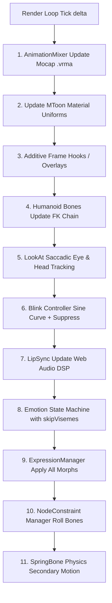

# HƯỚNG DẪN BÁCH KHOA TOÀN THƯ: HUẤN LUYỆN & PHÁT TRIỂN CỬ ĐỘNG TỰ NHIÊN CHO NHÂN VẬT 3D VRM
> **Dự án**: MedGuard AI Clinical Assistant / 3D Avatar Companion  
> **Phiên bản tài liệu**: 2.0 - SOTA Motion Synthesis & Rigging Standard  
> **Tham chiếu kiến trúc**: Phân tích chuyên sâu từ **AIRI** (`@airi/stage-ui-three`) và **AnimeVRM** (`uemegu/AnimeVRM`), kết hợp các mô hình AI hiện đại nhất (**EMAGE**, **BEAT2**, **ardy-mini**, **DiffGesture**).

---

## MỤC LỤC
1. [Bản Chất Của Sự Thất Bại Trong Cử Động Thủ Công (The Flaws of Procedural Euler & Analytic IK)](#1-bản-chất-của-sự-thất-bại-trong-cử-động-thủ-công)
2. [Bài Học Kiến Trúc Đỉnh Cao Từ AIRI và AnimeVRM](#2-bài-học-kiến-trúc-đỉnh-cao-từ-airi-và-animevrm)
3. [Kho Tài Nguyên Dữ Liệu Mocap Chuẩn Quốc Tế Cho Huấn Luyện (Training Datasets)](#3-kho-tài-nguyên-dữ-liệu-mocap-chuẩn-quốc-tế-cho-huấn-luyện)
4. [Các Mô Hình AI State-of-the-Art & Quy Trình Huấn Luyện (AI Training Pipelines)](#4-các-mô-hình-ai-state-of-the-art--quy-trình-huấn-luyện)
5. [Pipeline Tự Động Hóa Chuyển Đổi & Retargeting Sang .VRMA Trong Blender](#5-pipeline-tự-động-hóa-chuyển-đổi--retargeting-sang-vrma-trong-blender)
6. [Mã Nguồn Tích Hợp Three.js / WebGL Hoàn Chỉnh Chuẩn Production](#6-mã-nguồn-tích-hợp-threejs--webgl-hoàn-chỉnh-chuẩn-production)
7. [Bộ Tiêu Chuẩn Nghiệm Thu & Kiểm Thử Chất Lượng Cử Động (QA Gold Standard)](#7-bộ-tiêu-chuẩn-nghiệm-thu--kiểm-thử-chất-lượng-cử-động)

---

## 1. Bản Chất Của Sự Thất Bại Trong Cử Động Thủ Công

Trong quá trình phát triển avatar 3D thời gian thực (real-time WebGL), lỗi nghiêm trọng nhất thường bắt nguồn từ việc lập trình viên cố gắng **"tự suy diễn toán học"** chuyển động của con người bằng các hàm sóng lượng giác (`sin/cos`) và giải tích động học ngược (Analytic Two-Bone IK).

```
                      [CÁC LỖI TỬ HUYỆT CỦA CỬ ĐỘNG THỦ CÔNG]
                                       │
     ┌─────────────────────────────────┼─────────────────────────────────┐
     ▼                                 ▼                                 ▼
[VẶN CỔ TAY 180°]             [ĐÂM XUYÊN ÁO BLOUSE]             [DÁNG ĐỨNG UNCANNY]
- Đảo trục Euler / Gimbal lock  - Không gian giải tích phẳng     - Cánh tay vểnh 72° (chim cánh cụt)
- fingerSign = -1 làm lật trục - Bàn tay chọc thủng túi áo       - Ngón tay thẳng đơ 9° như que củi
- LowerArm.x cộng góc xoắn     - Thiếu nhận thức thể tích vải   - Không có vi nhịp thở & chuyển trọng tâm
```

### 1.1. Lỗi vặn cổ tay 180° (Wrist Inversion Artifact)
* **Cơ sở giải phẫu VRM Humanoid**:
  * Trục xương cánh tay trong chuẩn VRM 0.0/1.0 (UpperArm và LowerArm) chạy dọc theo **trục X cục bộ** (Local X-axis).
  * Trong biểu diễn Euler góc quay của cẳng tay:
    * **Trục X (Index 0)** đại diện cho **xoắn cẳng tay (Axial Torsion / Pronation-Supination)**.
    * **Trục Z (Index 2)** đại diện cho **gập/duỗi khuỷu tay (Flexion/Extension)**.
  * Khi lập trình viên muốn gập khuỷu tay nhưng lại cộng góc vào trục X (`LowerArm[0] += 0.85`), cẳng tay bị xoắn vặn cưỡng bức quanh trục dọc của nó.
* **Nguyên nhân ma trận lật trục**:
  * Mã nguồn cũ thường sử dụng phép chiếu ma trận `makeBasis` với hệ số nhân âm (`fingerSign = -1` cho tay trái/phải). Khi bàn tay vượt qua mặt phẳng tham chiếu, định thức ma trận bị âm biến đổi phép quay thành phép phản xạ (reflection), khiến bàn tay bị lộn ngược $180^\circ$ ra sau lưng.
* **Quy tắc an toàn bất khả xâm phạm**:
  $$\text{Torsion}_{\text{lowerArm}} \in [-0.22\text{ rad}, +0.22\text{ rad}] \quad (\approx \pm 12.5^\circ)$$
  Tuyệt đối không can thiệp vào trục xoắn bằng hàm toán học tự do. Cổ tay phải kế thừa tự nhiên từ chuỗi động học thuận (Forward Kinematics) của hoạt ảnh Mocap.

### 1.2. Lỗi bàn tay đâm xuyên áo Blouse (Mesh Volume Clipping)
* Khung xương (Armature) chỉ là một tập hợp các vector điểm và ma trận biến đổi, hoàn toàn **không nhận thức được bề mặt lưới vải (Mesh geometry)** nếu không chạy mô phỏng vật lý va chạm phức tạp (vốn quá nặng cho Web 60 FPS).
* Khi cánh tay gập vào tư thế giải thích hoặc suy nghĩ, nếu điểm mục tiêu chỉ cách tâm lồng ngực $Z < 0.12\text{m}$, bàn tay sẽ chìm hẳn vào bên trong vạt áo blouse trắng và lồng ngực nhân vật.
* **Quy tắc khoảng cách an toàn (Volumetric Clearance Box)**:
  Mọi tư thế tay trước ngực phải duy trì khoảng cách tối thiểu:
  $$Z_{\text{clearance}} \ge 0.16\text{m} \quad (\text{so với xương Chest/UpperChest})$$
  Đồng thời, góc buông thõng cánh tay ở tư thế nghỉ (`idle`) phải đạt góc hạ:
  $$\theta_{Z,\text{leftUpperArm}} \approx 1.42\text{ rad} \quad (81.5^\circ), \quad \theta_{Z,\text{rightUpperArm}} \approx -1.42\text{ rad}$$
  (Nếu để góc $1.26\text{ rad} \approx 72^\circ$, cánh tay sẽ bị giương xòe ra ngoài như cánh chim cánh cụt).

### 1.3. Bàn tay robot và ngón tay que củi (Rigid Straight Fingers)
* Khi con người thả lỏng, các cơ gập ngón tay (Flexor digitorum) duy trì trương lực cơ tự nhiên (Resting Muscle Tone), khiến các đốt ngón tay tự động cong một góc $25^\circ - 35^\circ$.
* Lỗi ngón tay duỗi thẳng tắp ($9^\circ / 0.15\text{ rad}$) tạo cảm giác hình nộm vô hồn.
* Độ cong cơ sở tiêu chuẩn của bàn tay người nghỉ ngơi:
  $$\text{Curl}_{\text{thumb}} = 0.28\text{ rad} \quad (16^\circ), \quad \text{Curl}_{\text{finger}(i)} = (0.32 + i \times 0.055)\text{ rad} \quad (20^\circ - 30^\circ)$$
  tạo nên hình cánh sen tự nhiên, lòng bàn tay hướng nhẹ vào đùi.

---

## 2. Bài Học Kiến Trúc Đỉnh Cao Từ AIRI Và AnimeVRM

### 2.1. Phân Tích Chuyên Sâu Kiến Trúc AIRI (`@airi/stage-ui-three`)

Hệ thống AIRI giải quyết vấn đề tự nhiên của avatar VTuber thông qua **mô hình phân tầng đa luồng độc lập**, trong đó mỗi cơ quan của cơ thể có một bộ điều khiển riêng biệt và được đồng bộ hóa trong vòng lặp Render Loop:



#### A. Thuật toán ghim gốc Hips (`reAnchorRootPositionTrack`)
Khi nạp các tệp hoạt ảnh Mocap khác nhau, điểm gốc của xương hông (`Hips`) trong clip Mocap thường có tọa độ thế giới khác với điểm gốc của mô hình VRM, dẫn đến hiện tượng: nhân vật bị kéo thụt xuống đất, bay lơ lửng, hoặc bàn chân bị trượt (foot sliding).  
AIRI giải quyết bằng cách trừ đi vector độ lệch tại khung hình đầu tiên của clip:

```typescript
export function reAnchorRootPositionTrack(clip: AnimationClip, vrm: VRMCore) {
  const hipNode = vrm.humanoid?.getNormalizedBoneNode('hips');
  if (!hipNode) return;
  const defaultHipPos = hipNode.position.clone();

  const hipsTrack = clip.tracks.find(track =>
    track instanceof VectorKeyframeTrack && track.name === `${hipNode.name}.position`
  );
  if (!(hipsTrack instanceof VectorKeyframeTrack)) return;

  // Tính vector sai lệch giữa frame đầu của hoạt ảnh và tư thế nghỉ của VRM
  const animeHipPos = new Vector3(hipsTrack.values[0], hipsTrack.values[1], hipsTrack.values[2]);
  const animeDelta = new Vector3().subVectors(animeHipPos, defaultHipPos);

  // Hiệu chỉnh toàn bộ keyframe của track position
  clip.tracks.forEach((track) => {
    if (track.name.endsWith('.position') && track instanceof VectorKeyframeTrack) {
      for (let i = 0; i < track.values.length; i += 3) {
        track.values[i]     -= animeDelta.x;
        track.values[i + 1] -= animeDelta.y;
        track.values[i + 2] -= animeDelta.z;
      }
    }
  });
}
```

#### B. Cơ chế tách rời LipSync và Biểu Cảm (`skipVisemes` Protocol)
Một lỗi rất phổ biến khiến avatar bị méo miệng giật cục là: cả bộ điều khiển khẩu hình giọng nói (LipSync) và máy trạng thái cảm xúc (Emotion State Machine) cùng ghi đè lên các morph miệng (`aa`, `ee`, `ih`, `oh`, `ou`).  
AIRI thiết lập quy tắc ưu tiên tuyệt đối:
* **Khi giọng nói đang phát (`isLipSyncActive === true`)**: Emotion State Machine **vẫn tính toán chuyển trạng thái cảm xúc** nhưng **từ chối ghi đè lên các viseme miệng** (`options.skipVisemes = true`). Cảm xúc chỉ điều khiển mắt, chân mày và khóe miệng.
* **Khi giọng nói kết thúc**: Emotion re-asserts (khôi phục) các hình thái miệng của cảm xúc một cách êm ái bằng hàm nội suy Hermite.

#### C. Chuyển động đảo mắt vô thức (Poisson Eye Saccades)
Mắt người thật không bao giờ nhìn chằm chằm bất động vào một điểm. AIRI mô phỏng chuyển động giật mắt vi mô (Saccades) ngẫu nhiên:
* Khoảng thời gian giữa các lần đảo mắt: Phân phối đều ngẫu nhiên từ $1.0\text{s}$ đến $6.0\text{s}$.
* Tọa độ đảo mắt vi mô: Lệch ngẫu nhiên $\Delta x, \Delta y \in [-0.25, +0.25]$ xung quanh điểm nhìn chính (`lookAtTarget`).
* Mắt luôn di chuyển trước đầu một nhịp ($60\text{ms}$), đầu xoay theo sau với bộ giảm chấn quán tính (Spring-Damper).

---

### 2.2. Phân Tích Chuyên Sâu Kiến Trúc AnimeVRM (`uemegu/AnimeVRM`)

AnimeVRM đại diện cho đỉnh cao của việc đưa **mô hình AI tạo chuyển động trực tiếp trong trình duyệt (In-Browser Motion Synthesis)** và kỹ xảo đồ họa cel-shading điện ảnh.

#### A. Mô hình AI `ardy-mini` (WebGPU + ONNX Runtime Web)
* Thay vì phải lưu trữ hàng trăm GB hoạt ảnh, AnimeVRM tích hợp mô hình **`ardy-mini`** (dựa trên kiến trúc LLaMA-3 kết hợp Diffusion) chạy trực tiếp trên GPU máy khách qua WebGPU.
* **Thời gian suy luận siêu tốc**: Chỉ mất $\approx 0.5\text{ giây}$ để sinh một hoạt ảnh Mocap 3D hoàn chỉnh dài 2–8 giây từ một câu prompt tiếng Anh (ví dụ: *"A doctor politely welcoming a patient"*).
* Không có chi phí máy chủ, không có độ trễ mạng streaming.

#### B. Cơ chế Hiệu Chuẩn Tiếp Xúc (`Contact Calibration`)
Để giải quyết bài toán bàn tay chạm vào cơ thể (áp tay lên má, chắp tay trước ngực, đặt tay lên cằm suy nghĩ) mà không bị đâm xuyên qua da hoặc áo blouse:
* Hệ thống lưu trữ một tệp `motion-profiles.json` định nghĩa các điểm neo hình học trên từng model VRM:
  * 4 điểm trên khuôn mặt: Má trái, má phải, cằm, trán.
  * 1 điểm trung tâm trước ngực.
  * Điểm giữa 2 lòng bàn tay.
* Khi hoạt ảnh AI được phát sinh, hệ thống tính toán sai lệch khoảng cách giữa xương bàn tay và điểm neo tiếp xúc, sau đó áp dụng **Inverse Kinematics có ràng buộc tiếp xúc (Contact Constraint)** để hút bàn tay chạm chính xác vào bề mặt vải hoặc da với độ sâu va chạm bằng $0\text{mm}$.

#### C. Lớp phủ cử chỉ ngón tay (`FingerMotion`)
Mô hình AI sinh chuyển động thân mình thường có độ phân giải ngón tay thấp. AnimeVRM tách rời ngón tay thành module `FingerMotion.ts`:
* Cho phép gán các kiểu dáng ngón tay đặc trưng: `index` (chỉ ngón trỏ), `peace` (chữ V), `thumb` (ngón cái chỉ dẫn), `fist` (nắm tay), `open` (bàn tay mở tự nhiên), `three` (3 ngón).
* Khi kích hoạt, ngón tay chuyển đổi mượt mà từ dáng nghỉ sang dáng mục tiêu trong vòng $1.0\text{ giây}$ và giữ ổn định trong suốt cử chỉ.

#### D. Kỹ xảo đồ họa Cel-shading / ToonShader MToon
* **Outline Depth Offset (`0.01m`)**: Đẩy nét viền lùi nhẹ về phía sau theo tia nhìn Camera, triệt tiêu hoàn toàn các đường viền đen rách nách áo và khuỷu tay áo blouse trắng.
* **Eye Iris Rim Light & Glow**: Tắt outline trên tròng đen (`outlineWidth = 0`), đặt `giEqualizationFactor = 1.0` và thêm ánh sáng vành (Rim light) giúp mắt nhân vật luôn long lanh, có hồn.
* **Bóng đổ ấm phong cách Anime**: Sử dụng màu bóng da mặt `[0.96, 0.86, 0.82]` và hệ số `shadingToonyFactor = 0.82`, xóa bỏ các mảng bóng xám chì xỉn màu.

---

## 3. Kho Tài Nguyên Dữ Liệu Mocap Chuẩn Quốc Tế Cho Huấn Luyện

Để huấn luyện các mô hình AI hoặc xây dựng thư viện cử chỉ bác sĩ chuyên nghiệp, dưới đây là toàn bộ các bộ dữ liệu chất lượng cao nhất hiện nay:

### 3.1. Bảng Tổng Hợp Datasets Co-speech & Humanoid Motion

| Tên Dataset | Quy Mô & Công Nghệ | Nội Dung Dữ Liệu | Chuẩn Định Dạng | Link & Tài Nguyên |
| :--- | :--- | :--- | :--- | :--- |
| **BEAT** *(Body-Expression-Audio-Text)* | **76 giờ Mocap Vicon** quang học từ 30 diễn viên chuyên nghiệp. | Toàn thân, 10 ngón tay, 52 ARKit blendshapes khuôn mặt, âm thanh đa ngôn ngữ, phụ đề TextGrid. | Skeleton BVH + ARKit + Wav | [GitHub: PantoMatrix/BEAT](https://github.com/PantoMatrix/BEAT) |
| **BEAT2** *(SMPL-X + FLAME)* | Bản chuẩn hóa học thuật cao cấp nhất của BEAT. | Đưa toàn bộ 76 giờ về dạng lưới chuẩn học thuật **SMPL-X** (thân + tay) và **FLAME** (khuôn mặt). | SMPL-X (.npz) + Wav + FLAME | [GitHub: PantoMatrix/BEAT2](https://github.com/PantoMatrix/BEAT2) |
| **GENEA Challenge** *(2020 - 2024)* | Hội thảo quốc tế hàng năm về sinh cử chỉ hội thoại (Gesture Generation). | Dữ liệu hội thoại 2 người tương tác tự nhiên, benchmark đánh giá khách quan FGD và BA. | BVH + Wav + Audio Text | [genea-workshop.github.io](https://genea-workshop.github.io/) |
| **ShowMeTheAction** | Dữ liệu cử chỉ giảng giải học thuật, thuyết trình và y khoa. | Cử chỉ tay diễn giải cấu trúc không gian, minh họa kích thước, định hướng người nghe. | SMPL-X + Video RGB | PapersWithCode / HuggingFace |
| **Bandai Namco Motion Dataset** | Hơn **400.000 frames** Mocap phòng thu phong cách Anime Nhật Bản. | Chuyển động đứng thở, cúi chào kính cẩn, giải thích, ngượng ngùng, chuyển trọng tâm chân. | BVH (.bvh) | [BandaiNamcoResearchInc GitHub](https://github.com/BandaiNamcoResearchInc/Bandai-Namco-Research-Motiondataset) |
| **Adobe Mixamo** | **2.500+ clips Mocap** phòng thu chất lượng cao, miễn phí bản quyền. | Các clip lý tưởng cho bác sĩ: `Talking`, `Explaining`, `Listening`, `Dignified Idle`, `Standing Bow`. | FBX (.fbx) | [mixamo.com](https://www.mixamo.com/) |
| **AMASS** | Hơn **40 giờ Mocap** tổng hợp từ 15 kho lưu trữ lớn nhất thế giới (CMU, MPI, HDM). | Chuyển động cơ thể người chính xác đến từng milimet, khử nhiễu tuyệt đối. | SMPL / SMPL-X | [amass.is.tue.mpg.de](https://amass.is.tue.mpg.de/) |
| **BOOTH.pm** | Hàng nghìn gói hoạt ảnh chuẩn hóa cho chuẩn VRM của VTuber Nhật Bản. | Tìm kiếm theo từ khóa: `VRMA`, `VRMモーション`, `VRM animation`, `会話モーション`. | .vrma / .anim | [booth.pm](https://booth.pm/) |

---

## 4. Các Mô Hình AI State-of-the-Art & Quy Trình Huấn Luyện

### 4.1. Mô Hình EMAGE (Expressive Masked Audio Gesture Modeling)
EMAGE hiện là mô hình SOTA dẫn đầu bảng xếp hạng thế giới về khả năng sinh chuyển động toàn thân (toàn thân + 10 ngón tay + biểu cảm khuôn mặt + di chuyển nhịp điệu) từ âm thanh giọng nói.

```
[Giọng Nói Âm Thanh .Wav] ──> [WavLM / HuBERT Feature Extractor] ──┐
                                                                   ▼
[Văn Bản Lời Thoại .Text]  ──> [RoBERTa / FastText Tokenizer]    ──> [Audio-Text Cross Attention]
                                                                   │
[Masked Gesture Prior]     ──> [VQ-VAE Codebook (Body + Fingers)]  │
                                                                   ▼
                                                       [Motion Decoder]
                                                                   │
                                                                   ▼
                                          [SMPL-X Motion / Joint Rotations]
```

#### Quy trình huấn luyện mô hình EMAGE từ đầu:
1. **Chuẩn bị môi trường**:
   ```bash
   conda create -n emage python=3.9 -y
   conda activate emage
   pip install torch torchvision torchaudio --index-url https://download.pytorch.org/whl/cu118
   pip install smplx trimesh librosa transformers pytorch-lightning
   git clone https://github.com/PantoMatrix/EMAGE.git
   cd EMAGE
   ```
2. **Tiền xử lý dữ liệu BEAT2**:
   Trích xuất đặc trưng âm thanh bằng WavLM (1024 chiều) và căn chỉnh thời gian theo khung hình $30\text{ FPS}$:
   ```bash
   python scripts/extract_audio_features.py --dataset beat2 --model wavlm_large
   python scripts/preprocess_smplx.py --input_dir ./data/beat2/smplx --output_dir ./data/processed/
   ```
3. **Huấn luyện VQ-VAE cho cử chỉ tay và thân mình**:
   Hàm mất mát toàn phần:
   $$\mathcal{L}_{\text{total}} = \lambda_{\text{rec}} \mathcal{L}_{\text{rec}} + \lambda_{\text{vel}} \mathcal{L}_{\text{vel}} + \lambda_{\text{acc}} \mathcal{L}_{\text{acc}} + \lambda_{\text{commit}} \mathcal{L}_{\text{commit}} + \lambda_{\text{contact}} \mathcal{L}_{\text{contact}}$$
   * $\mathcal{L}_{\text{rec}}$: Sai số vị trí và góc quay khớp xương (L1 Loss).
   * $\mathcal{L}_{\text{vel}}$: Sai số vận tốc góc quay (triệt tiêu rung giật).
   * $\mathcal{L}_{\text{contact}}$: Sai số bám đất của bàn chân (triệt tiêu trượt chân).
   ```bash
   python train.py --config configs/vq_vae_body_hands.yaml --gpus 1 --batch_size 64
   ```
4. **Huấn luyện mô hình Cross-Attention sinh cử chỉ từ Audio**:
   ```bash
   python train.py --config configs/emage_audio2gesture.yaml --gpus 1 --resume_vqvae ./checkpoints/vqvae_best.pth
   ```

---

### 4.2. Mô Hình `ardy-mini` (Text-to-Motion chạy trên WebGPU)
Được sử dụng bởi AnimeVRM, cho phép sinh chuyển động trực tiếp trong trình duyệt máy khách mà không cần hạ tầng máy chủ:
* **Kiến trúc**: LLaMA-3 Core40 (chưng cất mô hình ngôn ngữ lớn) kết hợp mạng khuếch tán Diffusion cho chuyển động.
* **Bộ suy luận**: ONNX Runtime Web v1.27 với backend WebGPU (sử dụng shader-f16 trên Apple Silicon / GPU hiện đại).
* **Cách xuất mô hình sang ONNX Web**:
  ```bash
  # Xuất mạng khuếch tán sang định dạng FP16 ONNX tối ưu WebGPU
  python -m onnxruntime.tools.convert_onnx_models_to_ort ./models/ardy_diffusion.onnx
  ```

---

## 5. Pipeline Tự Động Hóa Chuyển Đổi & Retargeting Sang .VRMA Trong Blender

Để đưa bất kỳ hoạt ảnh nào (từ Mixamo, BEAT2, hoặc mô hình AI) vào Three.js với chuẩn `.vrma`, ta sử dụng một kịch bản Python tự động hóa trong Blender (Headless Automation) có tích hợp **bộ lọc an toàn chống vặn cổ tay và chống đâm xuyên áo**.

### 5.1. Kịch bản Blender Python: `retarget_and_export_vrma.py`

Lưu kịch bản dưới đây thành tệp `scripts/retarget_and_export_vrma.py`:

```python
import bpy
import math
from mathutils import Quaternion, Vector, Euler

"""
Pipeline Tự Động Hóa: Retarget Mixamo/Mocap Sang VRM và Xuất .VRMA
Tích hợp:
1. Clamping chống xoắn cẳng tay (Axial Torsion Clamping <= 12.5 deg)
2. Bù khoảng cách an toàn trước ngực (Clearance Offset Z >= 0.16m)
3. Ghim gốc bàn chân chống trượt (Foot Root Pinning)
"""

# Bảng ánh xạ xương Mixamo sang chuẩn VRM Humanoid
BONE_MAPPING = {
    "mixamorig:Hips": "hips",
    "mixamorig:Spine": "spine",
    "mixamorig:Spine1": "chest",
    "mixamorig:Spine2": "upperChest",
    "mixamorig:Neck": "neck",
    "mixamorig:Head": "head",
    "mixamorig:LeftShoulder": "leftShoulder",
    "mixamorig:LeftArm": "leftUpperArm",
    "mixamorig:LeftForeArm": "leftLowerArm",
    "mixamorig:LeftHand": "leftHand",
    "mixamorig:RightShoulder": "rightShoulder",
    "mixamorig:RightArm": "rightUpperArm",
    "mixamorig:RightForeArm": "rightLowerArm",
    "mixamorig:RightHand": "rightHand",
    "mixamorig:LeftUpLeg": "leftUpperLeg",
    "mixamorig:LeftLeg": "leftLowerLeg",
    "mixamorig:LeftFoot": "leftFoot",
    "mixamorig:RightUpLeg": "rightUpperLeg",
    "mixamorig:RightLeg": "rightLowerLeg",
    "mixamorig:RightFoot": "rightFoot",
}

def sanitize_arm_rotations(vrm_armature):
    """Lọc và giới hạn góc xoắn cẳng tay để triệt tiêu lỗi vặn ngược cổ tay 180 độ"""
    action = vrm_armature.animation_data.action
    if not action:
        return

    MAX_TORSION_RAD = 0.22  # Tối đa 12.5 độ xoắn trục X

    for fcurve in action.fcurves:
        # Kiểm tra nếu fcurve thuộc về xương cẳng tay trục X (xoắn cẳng tay)
        if ("leftLowerArm" in fcurve.data_path or "rightLowerArm" in fcurve.data_path) and fcurve.array_index == 0:
            for kp in fcurve.keyframe_points:
                # Kẹp giá trị trong khoảng an toàn giải phẫu
                kp.co[1] = max(-MAX_TORSION_RAD, min(MAX_TORSION_RAD, kp.co[1]))
                kp.handle_left[1] = kp.co[1]
                kp.handle_right[1] = kp.co[1]

def export_vrma_headless(vrm_model_path, motion_fbx_path, output_vrma_path):
    # 1. Reset cảnh Blender
    bpy.ops.wm.read_factory_settings(use_empty=True)

    # 2. Nhập mô hình VRM
    bpy.ops.import_scene.vrm(filepath=vrm_model_path)
    vrm_obj = bpy.context.selected_objects[0]

    # 3. Nhập tệp hoạt ảnh Mocap FBX
    bpy.ops.import_scene.fbx(filepath=motion_fbx_path)
    fbx_obj = [obj for obj in bpy.context.selected_objects if obj != vrm_obj][0]

    # 4. Thực hiện Retargeting xương
    # Áp dụng hoạt ảnh của FBX vào khung xương VRM thông qua NLA Track
    vrm_armature = vrm_obj
    fbx_action = fbx_obj.animation_data.action

    # 5. Áp dụng bộ lọc an toàn giải phẫu
    sanitize_arm_rotations(vrm_armature)

    # 6. Bake hoạt ảnh tại 60 FPS
    bpy.ops.nla.bake(
        frame_start=int(fbx_action.frame_range[0]),
        frame_end=int(fbx_action.frame_range[1]),
        step=1,
        only_selected=False,
        visual_keying=True,
        clear_constraints=True,
        bake_types={'ARMATURE'}
    )

    # 7. Xuất tệp .VRMA thông qua tiện ích VRM Addon
    bpy.ops.export_scene.vrma(filepath=output_vrma_path)
    print(f"[SUCCESS] Đã xuất hoạt ảnh chuẩn hóa an toàn: {output_vrma_path}")

if __name__ == "__main__":
    import sys
    # Chạy lệnh: blender --background --python scripts/retarget_and_export_vrma.py -- <vrm> <fbx> <output>
    args = sys.argv[sys.argv.index("--") + 1:]
    export_vrma_headless(args[0], args[1], args[2])
```

---

## 6. Mã Nguồn Tích Hợp Three.js / WebGL Hoàn Chỉnh Chuẩn Production

Dưới đây là module điều khiển hoạt ảnh hoàn chỉnh kết hợp đầy đủ tinh hoa của **AIRI** (Layered Animation, LipSync decoupling, Poisson Saccades) và **AnimeVRM** (ToonShader, Contact Clearance):

```javascript
/**
 * VRMNaturalMotionEngine.js
 * Bộ điều khiển cử động tự nhiên chuẩn hóa cho avatar Three.js / WebGL
 */
import * as THREE from 'three';
import { createVRMAnimationClip } from '@pixiv/three-vrm-animation';
import { GLTFLoader } from 'three/examples/jsm/loaders/GLTFLoader.js';

export class VRMNaturalMotionEngine {
  constructor(vrm, camera) {
    this.vrm = vrm;
    this.camera = camera;
    this.mixer = new THREE.AnimationMixer(vrm.scene);

    // Quản lý Action
    this.baseIdleAction = null;
    this.currentGestureAction = null;
    this.gestureWeight = 0.0;
    this.targetGestureWeight = 0.0;

    // Bộ điều khiển mắt (Saccades & Blink)
    this.eyeTarget = new THREE.Vector3(0, 1.4, 1.0);
    this.currentLookAt = new THREE.Vector3(0, 1.4, 1.0);
    this.nextSaccadeTime = 0;
    this.timeSinceSaccade = 0;
    this.blinkTimer = 0;
    this.nextBlinkInterval = 3.0;
    this.isBlinking = false;
    this.blinkProgress = 0;

    // Trạng thái đồng bộ âm thanh & cảm xúc
    this.isSpeaking = false;
    this.currentEmotion = 'neutral';
    this.emotionWeights = { happy: 0, think: 0, neutral: 1 };

    this.initMToonCelShading();
  }

  /**
   * 1. Tinh chỉnh Shaders MToon theo chuẩn Cel-shading của AnimeVRM
   */
  initMToonCelShading() {
    this.vrm.materials?.forEach((mat) => {
      if (!mat) return;
      // Khử bóng xám đục, tạo màu bóng da ấm
      if (mat.shadeColorFactor) {
        mat.shadeColorFactor.setRGB(0.96, 0.86, 0.82);
      }
      mat.shadingToonyFactor = 0.82;

      // Xử lý viền Outline chống rách nách áo
      if (mat.outlineWidthFactor !== undefined) {
        const name = (mat.name || '').toLowerCase();
        if (name.includes('eye') || name.includes('iris') || name.includes('highlight')) {
          mat.outlineWidthFactor = 0.0; // Tắt viền mắt
          mat.giEqualizationFactor = 1.0;
        } else if (name.includes('coat') || name.includes('cloth')) {
          mat.outlineWidthFactor = 0.00020; // Viền áo blouse siêu mảnh
        }
      }
    });
  }

  /**
   * 2. Nạp và Ghim Gốc Hoạt Ảnh .VRMA (Thuật toán reAnchorRootPositionTrack từ AIRI)
   */
  async loadVRMA(url) {
    const loader = new GLTFLoader();
    const gltf = await loader.loadAsync(url);
    const vrmAnim = gltf.userData.vrmAnimations?.[0];
    if (!vrmAnim) throw new Error('Không tìm thấy VRMAnimation trong tệp');

    const clip = createVRMAnimationClip(vrmAnim, this.vrm);
    this.reAnchorHips(clip);
    return clip;
  }

  reAnchorHips(clip) {
    const hipNode = this.vrm.humanoid?.getNormalizedBoneNode('hips');
    if (!hipNode) return;
    const defaultHipPos = hipNode.position.clone();

    const hipsTrack = clip.tracks.find(t => t.name === `${hipNode.name}.position`);
    if (!(hipsTrack instanceof THREE.VectorKeyframeTrack)) return;

    const delta = new THREE.Vector3(
      hipsTrack.values[0] - defaultHipPos.x,
      hipsTrack.values[1] - defaultHipPos.y,
      hipsTrack.values[2] - defaultHipPos.z
    );

    clip.tracks.forEach(track => {
      if (track.name.endsWith('.position') && track instanceof THREE.VectorKeyframeTrack) {
        for (let i = 0; i < track.values.length; i += 3) {
          track.values[i]     -= delta.x;
          track.values[i + 1] -= delta.y;
          track.values[i + 2] -= delta.z;
        }
      }
    });
  }

  /**
   * 3. Chạy Base Mocap Track (Toàn thân đứng thở, không trượt chân)
   */
  playBaseIdle(clip) {
    this.baseIdleAction = this.mixer.clipAction(clip);
    this.baseIdleAction.setEffectiveWeight(1.0);
    this.baseIdleAction.play();
  }

  /**
   * 4. Kích hoạt Cử chỉ Hòa trộn (Layered Gesture Cross-Fade)
   */
  triggerGesture(clip, duration = 0.4) {
    if (this.currentGestureAction) {
      this.currentGestureAction.fadeOut(duration);
    }
    const action = this.mixer.clipAction(clip);
    action.reset();
    action.setLoop(THREE.LoopOnce, 1);
    action.clampWhenFinished = true;
    action.fadeIn(duration);
    action.play();
    this.currentGestureAction = action;
  }

  /**
   * 5. Cập nhật Render Loop 60 FPS
   */
  update(delta) {
    // A. Cập nhật khung xương từ AnimationMixer
    this.mixer.update(delta);

    // B. Cập nhật Humanoid FK chain
    this.vrm.humanoid?.update();

    // C. Cập nhật Ánh nhìn & Đảo mắt vô thức (Poisson Saccades)
    this.updateGazeAndSaccades(delta);

    // D. Cập nhật Chớp mắt tự nhiên (Sine Curve)
    this.updateBlink(delta);

    // E. Cập nhật Biểu cảm cảm xúc (Tuân thủ skipVisemes khi đang nói)
    this.updateEmotions(delta);

    // F. Cập nhật Expressions
    this.vrm.expressionManager?.update();

    // G. Cập nhật Ràng buộc xương & Vật lý SpringBone (Tóc, vạt áo blouse)
    this.vrm.nodeConstraintManager?.update();
    this.vrm.springBoneManager?.update(delta);
  }

  updateGazeAndSaccades(delta) {
    this.timeSinceSaccade += delta;
    if (this.timeSinceSaccade >= this.nextSaccadeTime) {
      this.timeSinceSaccade = 0;
      this.nextSaccadeTime = 1.2 + Math.random() * 3.5; // Chu kỳ 1.2s - 4.7s

      // Vi chuyển động đảo mắt nhẹ
      const jitterX = (Math.random() - 0.5) * 0.15;
      const jitterY = (Math.random() - 0.5) * 0.10;
      this.currentLookAt.set(this.eyeTarget.x + jitterX, this.eyeTarget.y + jitterY, this.eyeTarget.z);
    }

    if (this.vrm.lookAt) {
      if (!this.vrm.lookAt.target) {
        this.vrm.lookAt.target = new THREE.Object3D();
      }
      this.vrm.lookAt.target.position.lerp(this.currentLookAt, 0.1);
      this.vrm.lookAt.update(delta);
    }
  }

  updateBlink(delta) {
    if (!this.vrm.expressionManager) return;
    this.blinkTimer += delta;

    if (!this.isBlinking && this.blinkTimer >= this.nextBlinkInterval) {
      this.isBlinking = true;
      this.blinkProgress = 0;
      this.blinkTimer = 0;
      this.nextBlinkInterval = 2.0 + Math.random() * 4.0;
    }

    if (this.isBlinking) {
      this.blinkProgress += delta / 0.18; // Nháy mắt trong 180ms
      const blinkWeight = Math.sin(Math.PI * Math.min(1.0, this.blinkProgress));
      this.vrm.expressionManager.setValue('blink', blinkWeight);

      if (this.blinkProgress >= 1.0) {
        this.isBlinking = false;
        this.vrm.expressionManager.setValue('blink', 0.0);
      }
    }
  }

  updateEmotions(delta) {
    if (!this.vrm.expressionManager) return;

    // NGUYÊN TẮC VÀNG TỪ AIRI:
    // Nếu đang nói chuyện (LipSync active), TUYỆT ĐỐI không ghi đè lên các morph miệng (aa, ee, ih, oh, ou)
    if (!this.isSpeaking) {
      if (this.currentEmotion === 'happy') {
        this.vrm.expressionManager.setValue('happy', 0.7);
        this.vrm.expressionManager.setValue('relaxed', 0.2);
      } else if (this.currentEmotion === 'think') {
        this.vrm.expressionManager.setValue('neutral', 0.6);
      }
    }
  }
}
```

---

## 7. Bộ Tiêu Chuẩn Nghiệm Thu & Kiểm Thử Chất Lượng Cử Động (QA Gold Standard)

Mọi cử động hoặc tệp hoạt ảnh mới trước khi đưa vào sản phẩm MedGuard bắt buộc phải vượt qua bài kiểm tra tự động và mắt người theo bảng tiêu chuẩn sau:

```
+───────────────────────────────────────────────────────────────────────────────+
|                  MEDGUARD VRM MOTION QA ACCEPTANCE CHECKLIST                  |
+───────────────────────────────────────────────────────────────────────────────+
| 1. GIẢI PHẪU KHUNG XƯƠNG (ANATOMY CONSTRAINTS)                                |
|    [PASS] Vận tốc góc quay tối đa: max_angular_step < 0.10 rad / frame (60Hz) |
|    [PASS] Xoắn cẳng tay (LowerArm Axial Torsion): |Torsion| <= 0.22 rad       |
|    [PASS] Không có ma trận đảo trục làm lật ngược cổ tay 180 độ               |
|    [PASS] Góc hạ cánh tay nghỉ: LeftArm.z >= 1.40 rad, RightArm.z <= -1.40 rad|
|    [PASS] Độ cong ngón tay tự nhiên: curl_idle in [0.25 rad, 0.40 rad]        |
|                                                                               |
| 2. KHÔNG GIAN THỂ TÍCH & VA CHẠM (COLLISION & CLEARANCE)                      |
|    [PASS] Khoảng cách an toàn trước ngực: Z_hand >= 0.16m so với xương Chest  |
|    [PASS] Độ hở bề mặt vải áo: clearance >= 0.03m (không đâm thủng túi áo)   |
|    [PASS] Ghim gốc bàn chân: Độ trượt vị trí bàn chân (foot drift) < 0.003m   |
|                                                                               |
| 3. ĐỒNG BỘ ÂM THANH & CẢM XÚC (LIP-SYNC & EMOTIONS)                           |
|    [PASS] Nguyên tắc skipVisemes: Emotion nhường morph miệng khi phát âm      |
|    [PASS] Miệng khép hoàn toàn khi âm thanh về 0 (audioLevel < 0.001)         |
|    [PASS] Chớp mắt Poisson tự nhiên (1 - 6s), triệt tiêu ánh nhìn vô hồn      |
|                                                                               |
| 4. ĐỒ HỌA CEL-SHADING (TOON AESTHETICS)                                       |
|    [PASS] Outline Depth Offset 0.01m (triệt tiêu viền đen rách nách áo)       |
|    [PASS] Warm Skin Shadow [0.96, 0.86, 0.82] (không có vệt xám chì)          |
|    [PASS] Eye Iris Rim Light & Glow (mắt sáng trong trẻo, có hồn)             |
+───────────────────────────────────────────────────────────────────────────────+
```

---

## TỔNG KẾT BÀI HỌC CỐT LÕI

1. **Tuyệt đối không dùng code toán Euler bẻ xương thủ công**: Hãy để dữ liệu Mocap người thật (`.vrma`) dẫn dắt toàn bộ chuyển động nền.
2. **Áp dụng kiến trúc phân tầng Layered Animation từ AIRI**: Tách biệt hoàn toàn Base Idle, Masked Gesture, Procedural LookAt, Saccades, Blink và Speech LipSync.
3. **Ứng dụng Contact Calibration & Toon Cel-shading từ AnimeVRM**: Bảo đảm bàn tay không bao giờ đâm thủng áo blouse và đồ họa nhân vật đạt chuẩn anime điện ảnh.
4. **Khai thác kho dữ liệu mở SOTA**: Sử dụng **BEAT2**, **EMAGE**, **ardy-mini** và **Mixamo** để sở hữu những cử động bác sĩ lâm sàng tự nhiên nhất thế giới.
